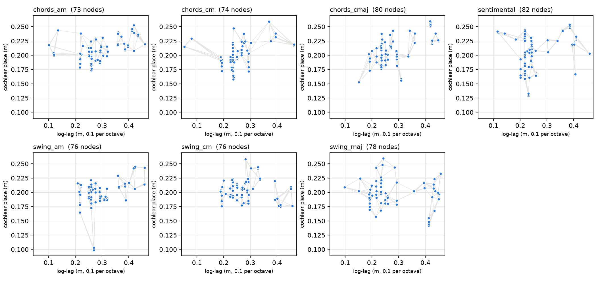
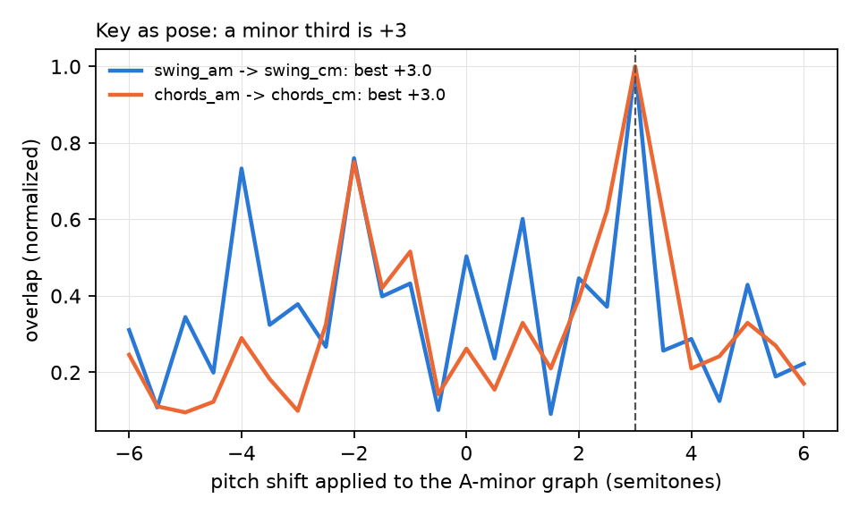

# Monty hears

AudioSM gives Monty ears: a CARFAC cochlea and a stabilized auditory image (SAI), turned into
feature-at-location like any other sensor. Learning and recognition run on stock Monty
(`DisplacementGraphLM` to learn, `EvidenceGraphLM` to recognize). No LM code changed.

A sound becomes a graph: x = period (log-lag, octaves), y = place on the cochlea. Pitch is in
octaves, so the same riff in another key is the same graph shifted. Key is pose.



## Benchmark

Seven guitar takes. I played them all. Monty learns a 15 s clip of each, then gets tested on a
different 15 s clip from later in the same take.

| experiment | question | result |
|---|---|---|
| `audio_riffs_eval_train_clips` | knows what it learned? | **7/7** |
| `audio_riffs_eval` | knows the held-out clips? | **5/7** |
| `audio_riffs_eval_transposed` | knows C minor, having only learned A minor? | **1/2** |

Every miss gets the tune right and the key or mode wrong:
- held-out `chords_am` → `chords_cmaj` (relative major, same notes)
- held-out `swing_am` → `swing_cm` (same riff, minor third up)
- transposed `swing_cm` → `swing_maj` (same riff, major)

Same answers and step counts every run. Measured on tbp.monty `main` (55c211b3), Python 3.13, uv.



Measured on the learned graphs, A minor → C minor lines up best at +3.0 semitones, a minor third,
for both the swing riff and the chords.

## Run it

```
uv sync --extra dev --extra audio
curl -L https://github.com/LMSBAND/tbp.monty/releases/download/audio-riffs-v1/audio_riffs.zip -o audio_riffs.zip
unzip audio_riffs.zip -d $MONTY_DATA          # -> $MONTY_DATA/audio_riffs/{takes,train,eval}

uv run pytest tests/unit/frameworks/models/audio
uv run python run.py experiment=audio_riffs_pretrain
uv run python run.py experiment=audio_riffs_eval
uv run python run.py experiment=audio_riffs_eval_train_clips
uv run python run.py experiment=audio_riffs_pretrain_no_cm
uv run python run.py experiment=audio_riffs_eval_transposed

uv run python benchmarks/audio/plot_audio_graphs.py \
  $MONTY_MODELS/my_trained_models/audio_riffs_pretrain/pretrained/model.pt out/
```

Pretrain is about 2 minutes on a desktop, each eval about 10 s. Results land in
`$MONTY_LOGS/projects/monty_runs/<experiment>/eval_stats.csv`.

## Dataset

`audio_riffs.zip` (89 MB): Minor Swing in A minor, C minor and major; For Sentimental Reasons
(the foil: same guitar, same register, different playing); a chord progression in A minor,
C minor and C major. Full takes, plus the train and held-out clips. Details are in its README.

## What's in the fork

- `src/tbp/monty/frameworks/models/audio/`: `AudioSM`, the ear, the SAI, CARFAC (google/carfac
  NumPy reference, vendored, Apache-2.0), and `fastear` (the same cochlea compiled with numba,
  optional)
- `src/tbp/monty/frameworks/environments/audio.py`: `AudioEnvironment` (objects are recordings)
- `src/tbp/monty/conf/`: the sensor module, LM tolerances, connectivity, environments, and five
  experiments
- `benchmarks/audio/plot_audio_graphs.py`: draws any trained audio LM's graphs
- `tests/unit/frameworks/models/audio/`: 12 tests; plus config snapshots

Touches two upstream files: one line in `SensorObservation` (a `waveform` key), and
`pyproject.toml` (the optional `audio` extra, plus lint and type excludes for the vendored CARFAC).

## Known limit

A steady tone is a single repeated point. With pitch as pose, one point fits a node of any graph,
and stock evidence can't say "no" on a feature mismatch (features score 0 to 1, pose adds about +1
per step regardless). So a held note that sits on another object's path never lets go. That
needs time as sequence (the [Global Interval Timer](https://docs.thousandbrains.org/docs/global-interval-timer))
or negative evidence in the LM. It's not a sensor fix.
